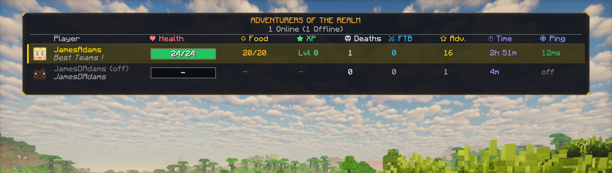

# RPG Tab Overlay (NeoForge 1.21.1)

A clean, highly customizable RPG-themed player list (TAB menu) replacement for Minecraft NeoForge 1.21.1.



#### (Choose your language below / Choisissez votre langue ci-dessous)
[](README.md)
[](README.fr-FR.md)

---

### 📌 Features
- **Fantasy RPG Design**: Dark semi-translucent backdrop framed with double gold/bronze trim and ornate corner accents.
- **Top Priority Display**: Automatically clears conflicting UI layers (such as RPG-HUD or PartyHUD) while holding the TAB key, guaranteeing full visibility.
- **Comprehensive Player Stats**:
  - **Player Avatar**: Dynamic player skin head rendering.
  - **FTB Team Name**: Displays the player's FTB Team name in italics directly below their username (e.g., *MyTeam*) only when the player belongs to a team.
  - **Player Dimension**: Displays each player's current dimension (Overworld, Nether, End, or custom mod dimension).
  - **Dynamic Health Bar**: Visual fill bar with exact numerical HP centered inside (e.g., `24/24`) and smooth color adaptation (green > orange > red).
  - **Food Level**: Hunger points displayed as `20/20`.
  - **XP Level**: Experience level formatted as `Lvl X`.
  - **Deaths Counter**: Vanilla statistics death count tracking.
  - **FTB Quests**: Total completed quests per team/player (safe reflection fallback if FTB Quests is not installed).
  - **Advancements**: Unlocked achievements count (crafting recipes are filtered out).
  - **Server Play Time**: Formatted total playtime (e.g., `2h 15m`).
  - **Latency / Ping**: Color-coded ping in milliseconds.
- **Offline Players Support**:
  - Displays data for previously connected players who are currently offline (play time, deaths, FTB quests, and JSON advancements).
- **Server Configuration** (`config/rpgtab-server.toml`):
  - Toggle any column on or off (avatar, health, food, xp, deaths, ftb, advancements, playtime, ping, fps, dimension).
  - Customizable title text and colors (HEX format `0xRRGGBB` or `#RRGGBB`).
  - Toggle offline player visibility (enabled by default).
  - **Pelican Panel API Integration**: Configure `[pelican_api]` (`pelicanUrl`, `pelicanApiKey`, `pelicanServerId`) to fetch actual real-time container metrics directly from the Pelican panel.
- **Client & Performance**:
  - **Client FPS**: Real-time FPS counter in the top-right corner of the TAB menu, fully compatible with **NeoForge GGTU (Resolution Scaler)** frame generation (displays total FPS, real frames, and generated frames).
- **Server Hardware & Network Metrics (Footer)**:
  - Real-time **TPS & MSPT** display with color indicators.
  - Server **CPU usage** percentage formatted against container allocated cores (e.g. `200%/600%`).
  - Allocated & container cgroup **RAM** usage (e.g. `1.7 Go / 16.0 Go`).
  - Container-level **Network transfer rates** (DL and UL in Ko/s or Mo/s via `/proc/net/dev`).
  - Real-time **Server Chunks**: Total loaded chunks on the server and real-time generating chunks (Vanilla + Distant Horizons).
  - Server **Uptime** since last reboot (⏱ Up:).
  - **GPU, C2ME OpenCL, Distant Horizons & SeedGen detection**: Displays the connected GPU name, C2ME OpenCL status, and Distant Horizons / SeedGen integration status.
  - Configurable server toggles in `config/rpgtab-server.toml` (`[server_metrics]`).

### 📂 Project Structure
```
rpgtab/
├── src/
│   ├── main/
│   │   ├── java/com/rpgtab/
│   │   │   ├── client/          # GUI rendering and client event listeners
│   │   │   ├── compat/          # FTB Quests & FTB Teams soft compatibility
│   │   │   ├── config/          # NeoForge server config specification
│   │   │   ├── network/         # S2C network synchronization packets
│   │   │   ├── server/          # Online & offline statistics collectors
│   │   │   └── RpgTabMod.java   # Mod entry point
│   │   └── resources/
│   │       └── META-INF/neoforge.mods.toml
│   └── test/
│       └── java/com/rpgtab/test/ # Standalone unit tests
└── build.ps1                    # Automated compilation and deployment script
```

### 🔨 Build Instructions
Requires Java 21 LTS (OpenJDK or Zulu):
```powershell
powershell -ExecutionPolicy Bypass -File build.ps1
```
The compiled JAR will be output to `build/` as `rpgtab-1.22.0-neoforge-1.21.1.jar`.
